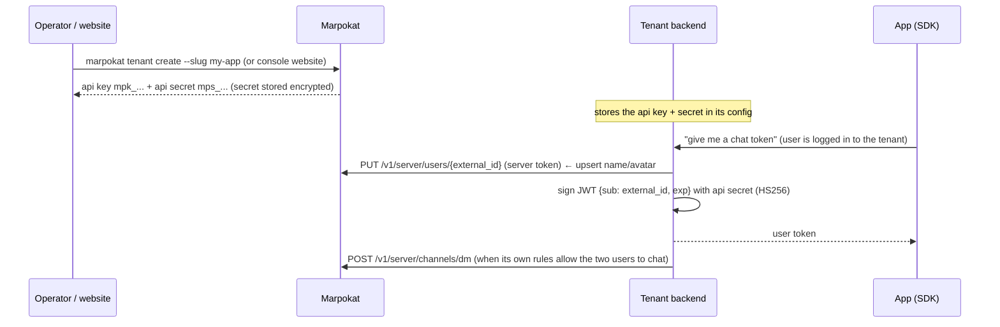
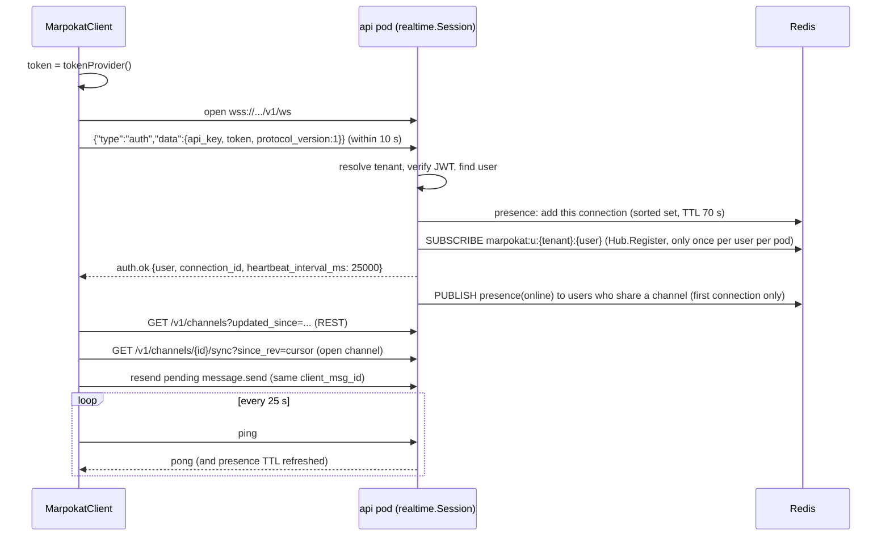
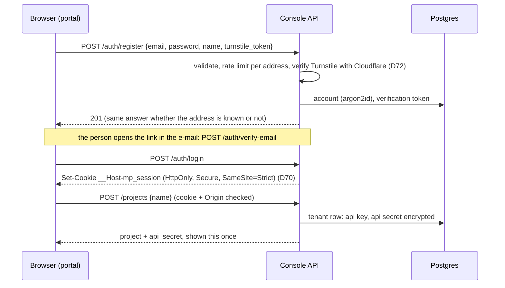

# Marpokat

Multi-tenant **chat as a service**: a Go backend (REST + WebSocket), SDKs for web and Android, and a protocol any
app can integrate. Developers sign up on a website, create a project and get the keys for their app; the website is
a separate repository (`marpokat-web`, two static Vue apps) that talks to this server's **Console API**.

Plan, decisions and progress: [`docs/PLAN.md`](docs/PLAN.md) (the `D<n>` numbers in code comments point there).

Hosts, credentials and infrastructure addresses are not in this repository: they are settings (environment variables,
Kubernetes secrets) of each deployment.

This README explains how the whole system works, end to end, and how to read the code. If you come from Java and are
new to Go, start with [Go for Java developers](#11-go-for-java-developers) and then follow
[How to read this codebase](#10-how-to-read-this-codebase).

**Contents**

1. [The idea in one minute](#1-the-idea-in-one-minute)
2. [Big picture](#2-big-picture)
3. [Tech stack: what each piece is and why it is here](#3-tech-stack-what-each-piece-is-and-why-it-is-here)
4. [Repository](#4-repository)
5. [How the server runs](#5-how-the-server-runs)
6. [The life of one HTTP request](#6-the-life-of-one-http-request)
7. [Complete flows](#7-complete-flows)
8. [The SDKs (JS and Android)](#8-the-sdks-js-and-android)
9. [Data model](#9-data-model)
10. [How to read this codebase](#10-how-to-read-this-codebase)
11. [Go for Java developers](#11-go-for-java-developers)
12. [Server quick start](#12-server-quick-start)
13. [Conventions](#13-conventions)
14. [Deployment](#14-deployment)

---

## 1. The idea in one minute

There are three parties:

| Party | Example | What it does |
| ----- | ------- | ------------ |
| **Tenant** (a customer app, a "project" on the website) | a social app | Has its own users and its own backend. Wants chat without building it |
| **Tenant backend** | the social app's API | Tells Marpokat who the users are (`PUT /v1/server/users/{id}`), signs a **user token** (JWT) for each of them, and decides who may chat with whom (e.g. opens DMs) |
| **App with the SDK** | its Android app, its web page | Asks its own backend for a token, then talks **directly** to Marpokat: WebSocket for live events, REST for the rest |
| **Marpokat** | this repo | Stores channels and messages, delivers them live, sends push notifications, stores files |
| **Developer** | whoever builds the social app | Signs up on the website, creates the project, copies its keys, sets up push |

Marpokat never handles passwords. It trusts a user because the tenant backend signed the token with its secret
(`D10`). Every row in the database has a `tenant_id`, so many apps share one deployment without seeing each other
(`D1`).

## 2. Big picture

```
                     ┌──────────────────────────┐
                     │  Tenant backend          │  signs user JWTs with its api secret,
                     │  (the customer's API)    │  upserts users, creates DMs (server token)
                     └──────┬─────────────▲─────┘
                 user token │             │ REST /v1/server/*
                            ▼             │
 ┌───────────────────────────────┐        │
 │ App: sdk-js / sdk-android      │        │
 │  MarpokatClient                │        │
 └───┬──────────────┬─────────┬──┘        │
     │ WebSocket    │ REST    │ PUT file   │
     │ /v1/ws       │ /v1/... │ (presigned URL)
     ▼              ▼         │            │
 ┌──────────────────────────────────────────────┐        ┌─────────────┐
 │ marpokat api   (N pods)                       │        │   MinIO     │◄──┘ files go straight
 │  :8080 public  REST + WebSocket               │        │ (S3 storage)│     to storage, never
 │  :9090 mgmt    /healthz /readyz /metrics      │        └──────▲──────┘     through the api
 │  :CONSOLE_ADDR website API (optional)         │               │
 └──┬──────────────────────┬─────────────────────┘               │
    │ SQL (one transaction:│ PUBLISH / SUBSCRIBE                 │ thumbnails
    │ message + outbox row)│ marpokat:u:{tenant}:{user}           │
    ▼                      ▼                                     │
 ┌────────────┐      ┌───────────┐                               │
 │ PostgreSQL │      │   Redis   │  live fan-out between pods,    │
 │ via        │      │           │  presence, rate limits,        │
 │ pgbouncer  │      └─────▲─────┘  push de-duplication          │
 └─────▲──────┘            │                                     │
       │ poll outbox       │                                     │
 ┌─────┴───────────────────┴─────────────────────────────────────┴──┐
 │ marpokat worker  (N pods)                                         │
 │  outbox relay ─► RabbitMQ ─► push consumer ─► FCM (Google) ─► phone│
 │                           └► media consumer ─► thumbnails          │
 └────────────────────────────────────────────────────────────────────┘
```

The website sits beside this, not in front of it:

```
 Browser ── portal (static Vue) ──┐   same host: /console/v1 is routed to the Console API,
 Browser ── admin  (static Vue) ──┤   everything else to the app's files
                                  ▼
                       marpokat api, Console API listener (CONSOLE_ADDR)
                       accounts, sessions (HttpOnly cookie), projects = tenants, audit
```

Two delivery paths, on purpose:

- **Fast path, best effort** (`D4`, `D40`): after a message is committed, the api publishes an event to Redis, and
  every api pod that holds a WebSocket of a recipient forwards it. If an event is lost, the client notices a gap in
  the per-channel counter and calls `sync`. **The database is the truth; Redis is just a quick notification.**
- **Durable path** (`D5`, `D6`): in the same database transaction as the message, an `outbox` row is written. The
  worker moves those rows to RabbitMQ, where jobs (push notifications, thumbnails) are retried until they succeed.
  Nothing that *must* happen is lost, even if a pod or the broker crashes.

## 3. Tech stack: what each piece is and why it is here

| Piece | What it is | Purpose in Marpokat |
| ----- | ---------- | ------------------- |
| **Go 1.26** | Compiled language with cheap concurrency (goroutines) | The whole server. One small static binary; thousands of open WebSockets cost little memory (`D2`) |
| **PostgreSQL 17** | Relational database | Source of truth: tenants, users, channels, members, messages, attachments, devices, outbox. ACID transactions keep *seq + message + outbox* consistent (`D3`) |
| **pgbouncer** (transaction mode) | Connection pooler in front of Postgres | Many pods share few real DB connections. Side effects you will see in code: the *simple protocol*, no `LISTEN/NOTIFY`, arrays passed as comma text (`D7`, `D27`, `D33`) |
| **pgx** | Postgres driver for Go | Like JDBC driver + HikariCP pool (`pgxpool`) |
| **sqlc** | Code generator: SQL → type-safe Go | You write SQL in `server/queries/*.sql`, `make gen` writes Go methods in `internal/store`. Think MyBatis/jOOQ, but generated at build time |
| **goose** | Migration tool | `server/migrations/*.sql`, embedded in the binary, run by `marpokat migrate` (like Flyway) |
| **Redis 7** | In-memory store with Pub/Sub | (1) Pub/Sub fan-out of live events between api pods, (2) presence (who is online), (3) rate limiting (token bucket in Lua), (4) push de-duplication. Every key is prefixed `marpokat:` (`D20`) |
| **RabbitMQ 4** | Message broker with acks, TTL and dead letters | Durable jobs: push and thumbnails, with retries after 10 s, 1 min, 10 min, then a dead letter queue (`D5`, `D48`) |
| **MinIO** | S3-compatible object storage | Attachments. Clients upload and download with **presigned URLs**; files never pass through the api (`D12`) |
| **FCM HTTP v1** | Firebase Cloud Messaging | Push to phones, with each tenant's own Firebase credentials stored encrypted (`D13`, `D50`) |
| **coder/websocket** | WebSocket library | The `/v1/ws` endpoint |
| **golang-jwt** | JWT library | Verifies HS256 user/server tokens signed by tenants |
| **net/http** (standard library) | HTTP server + router | No framework. Go 1.22+ `ServeMux` understands `"POST /v1/channels/{channel_id}/messages"` |
| **Prometheus client** | Metrics | `/metrics` on the management port |
| **slog** | Structured logging (standard library) | One JSON line per log |
| **testcontainers** | Starts real Postgres in Docker for tests | Integration tests (`*_integration_test.go`) |
| **Docker / Jenkins / Argo CD** | Build and deploy | See [Deployment](#14-deployment) |
| **OpenAPI + events.md** | The contract | `spec/openapi.yaml` (REST), `spec/events.md` (WebSocket). Written *before* code (`D15`); the SDK types are generated from it |
| **TypeScript** (`sdk-js`) | Web SDK + React hooks | `MarpokatClient` for browser/Node, IndexedDB cache |
| **Kotlin + OkHttp + coroutines** (`sdk-android`) | Android SDK | `MarpokatClient` exposing a `StateFlow<ChatState>`, Room cache, FCM helper |

## 4. Repository

| Path            | What                                                                     |
| --------------- | ------------------------------------------------------------------------ |
| `server/`       | Go backend, one binary: `marpokat api`, `worker`, `migrate`, `tenant`, `account` |
| `spec/`         | The contract: `openapi.yaml` (chat REST), `events.md` (WebSocket), `console.yaml` (website API) |
| (other repo) `marpokat-web` | The website: the portal (developers) and the admin app (operators), static Vue apps on the Console API |
| `examples/`     | `web-chat`: a one-file client to try the chat by hand                    |
| `sdk-js/`       | `@rizkysiregar/marpokat-core` and `@rizkysiregar/marpokat-react`          |
| `sdk-android/`  | Kotlin SDK: `marpokat-core` and `marpokat-android`                        |
| `docs/`         | Plan and integration docs                                                |

### Server layout

```
server/
├── cmd/marpokat/main.go     main(): reads os.Args[1] and calls app.RunAPI / RunWorker / RunMigrate / ...
├── internal/
│   ├── app/                 WIRING. Builds every object and connects them (the "Spring config", by hand)
│   │   ├── api.go             RunAPI: open DB/Redis/MinIO, build servers, run until SIGTERM
│   │   ├── routes.go          PublicRoutes: create services, register every HTTP route
│   │   ├── worker.go          RunWorker: open DB/Redis/RabbitMQ/MinIO, start jobs
│   │   ├── worker_core.go     NewWorker: outbox relay, push consumer, media consumer, cleaners
│   │   ├── console.go         the website (console) API server
│   │   └── tenantcmd.go, accountcmd.go, migrate.go   CLI subcommands
│   │
│   ├── auth/                X-Api-Key + JWT verification, middleware User / Server
│   ├── tenant/              tenants, api key → tenant resolver (cached 30 s), purge of deleted projects
│   ├── user/                users of a tenant (upsert by external id), GET /v1/me
│   ├── channel/             DMs and groups, members, freeze
│   ├── message/             send, history, sync, edit, delete, reactions, read marks
│   ├── media/               attachments: presigned upload, complete, thumbnails, cleaner
│   ├── device/              push tokens (POST /v1/devices)
│   ├── realtime/            WebSocket: Hub, Session, Publisher (Redis), Presence, control topic between pods
│   ├── outbox/              write events in the transaction; Relay moves them to RabbitMQ
│   ├── broker/              RabbitMQ topology, publisher with confirms, consumer with retries
│   ├── push/                push processor: who gets a push, FCM sender, de-dup
│   ├── console/             the Console API: accounts, cookie sessions, projects, deletion, admin, audit, Turnstile
│   ├── store/               GENERATED by sqlc from queries/*.sql. Do not edit
│   ├── testdb/              test helper: a fresh Postgres per test
│   └── platform/            infrastructure, no business logic
│       ├── config/            env vars → structs
│       ├── db/                pgx pool (simple protocol for pgbouncer)
│       ├── redisx/            Redis client + key prefix
│       ├── rabbitmq/          a connection that reconnects by itself
│       ├── storage/           MinIO client
│       ├── httpx/             JSON helpers, error format, middleware, server start/stop
│       ├── health/            /healthz, /readyz
│       ├── metrics/           Prometheus registry
│       ├── ratelimit/         token bucket in Redis
│       ├── secretbox/         encryption of tenant secrets (MARPOKAT_MASTER_KEY)
│       └── migrate/           goose runner
├── migrations/              goose SQL, embedded in the binary (embed.go)
├── queries/                 hand-written SQL that sqlc turns into internal/store
├── Makefile, Dockerfile, docker-compose.yml, Jenkinsfile, sqlc.yaml
```

Every feature package has the same three layers, which will feel familiar from Spring:

| File | Role | Spring equivalent |
| ---- | ---- | ----------------- |
| `handler.go` | Parse HTTP request, call service, write JSON | `@RestController` |
| `service.go` | Business rules, transactions | `@Service` |
| `internal/store/*.sql.go` (generated) | SQL | `@Repository` / MyBatis mapper |
| `model.go` | Response shapes | DTOs |

## 5. How the server runs

### One binary, several commands

`server/cmd/marpokat/main.go` is the only `main`. It looks at the first argument:

```
marpokat api               public REST + WebSocket API          → app.RunAPI      (internal/app/api.go)
marpokat worker            background jobs                       → app.RunWorker   (internal/app/worker.go)
marpokat migrate [up|down|status]                                → app.RunMigrate  (internal/app/migrate.go)
marpokat tenant <command>  create tenants, rotate secrets, sign test tokens   (internal/app/tenantcmd.go)
marpokat account <command> manage website accounts               (internal/app/accountcmd.go)
```

In Kubernetes the same image runs as two Deployments (`api`, `worker`) and one Job (`migrate`, before each sync).

`main` also creates a `context` that is cancelled on Ctrl+C / SIGTERM. That context is passed down everywhere; when
it is cancelled, every loop and server stops. (A `context.Context` is Go's way to carry "stop now" and deadlines,
see [section 11](#11-go-for-java-developers).)

### What `marpokat api` does at startup (`internal/app/api.go`)

1. `config.Load[apiConfig]()` reads environment variables into structs (`internal/platform/config`). `.env` locally.
2. Opens the encryption box for tenant secrets (`MARPOKAT_MASTER_KEY`).
3. Opens the Postgres pool, the Redis client and the MinIO client. If one fails, the process exits.
4. Builds a health registry: `/readyz` is OK only if Postgres, Redis, storage *and* the realtime Redis subscription
   are OK (`D24`, `D46`).
5. Creates the realtime `Hub` (holds this pod's WebSockets and their Redis subscriptions).
6. Builds the **public server** on `:8080`: `PublicRoutes(...)` wrapped by middleware (CORS, request id, logging +
   metrics, panic recovery, NUL-character check).
7. Builds the **management server** on `:9090` (`/healthz`, `/readyz`, `/metrics`, never exposed to the internet, `D23`).
8. Optionally the **console server** (website API) on `CONSOLE_ADDR`. It shares the database and Redis, but has its
   own listener and router: the ingress of the website's hosts sends `/console/v1` there, never the chat API's host.
9. Starts everything in parallel with an `errgroup` (like `ExecutorService` + `invokeAll`, where the first error
   cancels the rest) and waits.

On SIGTERM: `/readyz` starts failing at once, the servers keep serving for `SHUTDOWN_DELAY` so the ingress stops
sending traffic, then the servers stop and open WebSockets are closed with code `1012` so clients reconnect to
another pod (`D22`).

### What `marpokat worker` does (`internal/app/worker.go`, `worker_core.go`)

Opens Postgres, Redis, RabbitMQ, MinIO, then runs these jobs in parallel goroutines:

| Job | Code | What it does |
| --- | ---- | ------------ |
| Outbox relay | `outbox/relay.go` | Every 200 ms: lock up to 100 unpublished `outbox` rows (`FOR UPDATE SKIP LOCKED`), publish to RabbitMQ, mark them published *after* the broker confirms |
| Push consumer | `push/processor.go` | Reads queue `marpokat.push` (`message.created` events) and sends FCM pushes |
| Media consumer | `media/processor.go` | Reads queue `marpokat.media` (`attachment.uploaded`): thumbnails, blurhash, video poster (ffmpeg) |
| Outbox cleaner | `outbox/relay.go` | Deletes published events older than 7 days |
| Attachment cleaner | `media/cleaner.go` | Deletes uploads nobody used, and files of deleted messages |
| Project purge | `tenant/purge.go` | Every 10 min: projects whose deletion grace period is over lose their files (object prefix `<tenant id>/`) and every row, in one locked transaction (`D75`) |
| Stats | `broker/stats.go`, relay | Metrics: outbox pending, queue lengths (alert when a DLQ is not empty) |

There is no web endpoint on the worker except the management port (`:9091` locally).

## 6. The life of one HTTP request

Example: `POST /v1/channels/{channel_id}/messages` with headers `X-Api-Key: mpk_...` and
`Authorization: Bearer <user JWT>`.

```
net/http server (httpx/server.go)
 └─ WithCORS → WithRequestID → WithObservability → WithRecover → WithCleanInput   (httpx/middleware.go, api.go)
     └─ ServeMux matches "POST /v1/channels/{channel_id}/messages"               (message/handler.go Register)
         └─ mw.User  (auth/middleware.go)
         │    1. X-Api-Key → tenant + secret      (tenant/resolver.go, cached 30 s)
         │    2. verify JWT HS256 with that secret → sub = external user id   (auth/token.go)
         │    3. external id → internal user uuid (user must have been upserted by the tenant, D28)
         │    4. per-user rate limit in Redis
         │    5. put Principal{Tenant, UserID} in the request context
         └─ message.Handler.send   (message/handler.go)
              parse path + JSON body
              └─ message.Service.Send   (message/service.go)
                   validate, check membership, idempotency (client_msg_id), rate limit
                   BEGIN
                     message.Append (message/append.go)
                       UPDATE channels SET last_seq = last_seq+1   ← row lock: one channel commits in order
                       INSERT messages (seq = rev_seq = new last_seq)
                       INSERT message_attachments
                       INSERT outbox ('message.created')          ← durable event, same transaction
                     UPDATE channel_members SET last_read_seq      ← sender has read their own message
                   COMMIT
                   notifier.MessageCreated(...)  → Redis PUBLISH   ← live event, after commit
              httpx.WriteJSON(201, message)
```

Errors: services return special error values (`httpx.ErrNotFound(...)`, `httpx.FieldErrors{...}`), and
`httpx.WriteErr` turns them into the JSON error format of the spec. Any other error becomes a logged `500`. This is
Go's replacement for `@ControllerAdvice` + exceptions.

Server routes (`/v1/server/*`) use `mw.Server` instead: same api key, but a short-lived *server token*
(`{server: true}`, max 5 minutes) signed by the tenant backend.

## 7. Complete flows

### 7.1 Setting up a tenant and a user



The tenant decides who may chat with whom (`D11`). Clients can only create DMs or groups if the tenant config allows
it (`client_can_create_dm`, `client_can_create_group`).

### 7.2 Connecting the WebSocket



Credentials travel in the first frame, not in the URL, because browsers cannot set headers on a WebSocket. Each
session has one goroutine reading frames (in order) and one writing from a buffered queue of 256; a client too slow
to drain it is closed with `1013` and catches up with sync (`D45`).

### 7.3 Sending a message (the core flow)

Alice (web) sends "hi" to Bob (Android) in a DM. Alice and Bob are connected to **different api pods**.

```mermaid
sequenceDiagram
    participant A as Alice SDK
    participant P1 as api pod 1
    participant DB as Postgres
    participant R as Redis
    participant P2 as api pod 2
    participant B as Bob SDK
    A->>A: send(): pending[clientMsgId] = {status: sending}  (UI shows it grey)
    A->>P1: message.send {id:"m:<cid>", channel_id, client_msg_id, text}
    P1->>DB: BEGIN; bump channel seq; insert message; insert outbox; mark read; COMMIT
    P1-->>A: ack {message}  → pending removed, message stored, cursor = rev_seq
    P1->>DB: list active members of the channel
    P1->>R: PUBLISH marpokat:u:{t}:{alice} and marpokat:u:{t}:{bob}  (origin = Alice's connection)
    R-->>P1: alice's topic → Hub.dispatch: skip the origin connection, deliver to Alice's other tabs/devices
    R-->>P2: bob's topic → Hub.dispatch → session.enqueue
    P2-->>B: message.new {channel_id, rev_seq, message}
    B->>B: rev_seq == cursor+1 → apply; unread +1 or markRead if open
```

Code path on the server for the WebSocket version:
`realtime/session.go onSend` → `message.Service.Send` (same function as REST, with `Origin` = connection id) →
`realtime/publisher.go MessageCreated` → `publish` (Redis pipeline, one PUBLISH per recipient) →
on each pod `realtime/hub.go dispatch` → `Session.enqueue` → writer goroutine → socket.

Why per-user topics and not per-channel (`D39`)? Membership is read from the database at publish time, so it is
always correct, and a pod only subscribes for the users actually connected to it.

**Idempotency** (`D9`): `client_msg_id` is unique per sender and channel. If the ack was lost and the SDK resends,
the server returns the existing message instead of creating a second one.

### 7.4 Ordering, gaps and sync

Each channel has **one counter** (`channels.last_seq`, `D8`). Every change takes the next value:

- new message: `seq = rev_seq = n`
- edit, delete, reaction, attachment ready: the message's `rev_seq = n` (its `seq` stays)

The client keeps a **cursor** per channel = highest `rev_seq` applied:

| Incoming `rev_seq` | Client does |
| ------------------ | ----------- |
| `== cursor + 1` | apply, `cursor = rev_seq` |
| `<= cursor` | duplicate, ignore |
| `> cursor + 1` | apply, then `GET /v1/channels/{id}/sync?since_rev=<cursor>` to fill the gap |

Sync is one query (`rev_seq > cursor`) and covers new, edited, deleted messages and reactions. That is why the Redis
path can be best effort. Full rules: [`spec/events.md`](spec/events.md) section 6 and 7.

### 7.5 Push notification (durable path)

```mermaid
sequenceDiagram
    participant DB as Postgres (outbox)
    participant W as worker: Relay
    participant MQ as RabbitMQ
    participant PC as worker: push.Processor
    participant F as FCM
    participant Ph as Bob's phone
    W->>DB: SELECT ... FROM outbox WHERE published_at IS NULL FOR UPDATE SKIP LOCKED
    W->>MQ: publish to exchange marpokat.events, routing key message.created  (wait for confirm)
    W->>DB: mark published; COMMIT
    MQ->>PC: queue marpokat.push delivers the event
    PC->>DB: load message, push recipients (not sender, not muted, not read yet)
    PC->>PC: drop users who are online (Redis presence), system messages, messages > 10 min old
    PC->>DB: devices of those users
    PC->>F: HTTP v1 send (tenant's Firebase credentials), de-dup per device in Redis
    F->>Ph: data message
    Ph->>Ph: MarpokatPush.parse(message.data) → show notification, tap opens channelId
```

If the handler returns an error, the consumer (`broker/consumer.go`) sends the message to `marpokat.push.retry.1`
(10 s TTL), then `.retry.2` (1 min), `.retry.3` (10 min), then `marpokat.push.dlq`. The relay may publish an event
twice after a crash (at-least-once, `D47`); consumers tolerate duplicates (push de-dup in Redis).

### 7.6 Sending a picture

```mermaid
sequenceDiagram
    participant SDK
    participant API as api
    participant S3 as MinIO
    participant W as worker (media)
    SDK->>API: POST /v1/attachments {mime, size, file_name}
    API-->>SDK: {attachment (pending), upload_url, upload_headers}
    SDK->>S3: PUT file to upload_url  (presigned, file never touches the api)
    SDK->>API: POST /v1/attachments/{id}/complete   → size checked; status processing; outbox attachment.uploaded
    SDK->>API: message.send {attachment_ids:[id]}   (allowed while processing, D57)
    W->>S3: read original, write 640px JPEG thumbnail + blurhash (or ffmpeg poster for video)
    W->>W: attachment ready; message gets a new rev_seq
    W-->>SDK: message.updated (via Redis, like the api)
```

Downloads use short-lived presigned GET URLs that the server puts in each `Attachment` it returns.

### 7.7 Reconnect

On a closed socket (except `4003` bad credentials and `4005` bad protocol), the SDK waits
`random(0, min(30 s, 500 ms × 2^attempt))` (full jitter), reconnects, re-auths (new token after `4004` = token
expired), reloads changed channels, syncs open channels from their cursor and resends pending messages. Code `1012`
(server restarting, e.g. deploy) reconnects immediately. If the Hub loses its Redis subscription it closes all its
sessions with `1012` on purpose: a reconnect + sync is better than silently missing events (`D41`).

### 7.8 The website: accounts and projects (Console API)

`spec/console.yaml`, package `internal/console`. The website's apps are static files with no logic: every rule is
here.



Every request that changes something must carry an `Origin` of the portal or the admin app, and a JSON body: with
the `SameSite=Strict` cookie that rules out cross-site requests. A sign in from the admin app's origin gives an
**admin session**, only to platform administrators, and only such a session can use `/admin/*` (`D71`).
Administrators are made with the CLI (`marpokat account promote`), never through the API (`D66`).

### 7.9 Switching a project off, deleting it

| Action | What happens |
| ------ | ------------ |
| Switch off | `tenants.disabled_at` is set. Every pod is told at once over the Redis control topic (`marpokat:ctl`): it forgets the cached key, and **closes that tenant's open WebSockets with `4003`** (`D77`). New requests and connections are refused |
| Delete | Switched off as above, and `delete_after` = now + grace period (3 days by default). It can be restored until then (it stays off), and does not count against the project limit (`D75`) |
| Purge | The worker removes a project whose `delete_after` has passed: files first, then all its rows in one transaction; the owner gets `project_deleted` in their security log |
| Rotate secret, change settings | Stored, then announced on the same control topic: every pod drops its cached copy at once |

## 8. The SDKs (JS and Android)

Both SDKs implement the same rules from `spec/events.md`; their code is structured almost identically, so reading
one helps with the other.

| Concern | sdk-js (`packages/core/src/client.ts`) | sdk-android (`core/.../MarpokatClient.kt`) |
| ------- | -------------------------------------- | ------------------------------------------ |
| Entry | `new MarpokatClient({baseUrl, apiKey, tokenProvider, cache})` | `MarpokatClient(MarpokatOptions(...))` |
| State to the UI | `subscribe(listener)` + snapshot; React hooks in `packages/react` | `client.state: StateFlow<ChatState>` |
| Threading | single JS event loop | every mutation runs on one `limitedParallelism(1)` dispatcher (`loop`), so no locks |
| Socket + HTTP | `WebSocket`, `fetch` | `Transport.kt`: OkHttp behind `HttpTransport` / `SocketFactory` interfaces (fakes in tests) |
| Connect | `open()` → `auth` frame → `onAuthOk` | `open()` → `onOpen` → `onAuthOk` |
| Incoming frames | `onFrame(f)` switch on `f.type` | `onFrame(text)` `when (type)` |
| Cursor / gap | `revision(ch, rev)` → `scheduleSync` | `revision(id, rev)` → `scheduleSync` |
| Send | `send()` → `pending` map → `transmit()` (`message.send`, id `m:<clientMsgId>`) | same names |
| Reconnect | `onClosed(code)` with full jitter | `onSocketClosed(code)` |
| Upload | `upload()`: create → PUT with progress → complete | same |
| Cache | `cache.ts` (IndexedDB) | `android/RoomChatCache.kt` (Room) |
| Platform extras | — | `AppLifecycleConnector` (connect in foreground, disconnect in background so the server sends pushes instead), `MarpokatPush.parse` for FCM data, `registerPushToken` |

Typical use in an app:

```kotlin
val client = MarpokatClient(MarpokatOptions(baseUrl, apiKey, tokenProvider = { myApi.chatToken().token }))
AppLifecycleConnector.attach(client)
client.state.collect { render(it.channels, it.messages, it.pending) }
client.openChannel(id); client.send(id, "hi")
```

The SDKs' own READMEs (`sdk-js/README.md`, `sdk-android/README.md`) cover build, test and publishing.
`examples/web-chat/` is a no-build client that shows every frame, useful to watch the protocol live.

## 9. Data model

Main tables (`server/migrations/00001_init.sql` and later):

| Table | Holds | Notes |
| ----- | ----- | ----- |
| `tenants` | apps: api key, encrypted secret, config, FCM credentials | |
| `users` | users per tenant, keyed by `external_id` (the tenant's own id) | created only by the tenant backend |
| `channels` | DMs and groups; `last_seq` = the per-channel counter | locked on every new message |
| `channel_members` | membership, role, `last_read_seq`, `left_at`, mute | unread = others' messages after `last_read_seq` |
| `messages` | `(channel_id, seq)`, `rev_seq`, `client_msg_id`, text, type, metadata | deletes are tombstones |
| `message_reactions`, `message_attachments`, `attachments` | reactions, files and their status | |
| `devices` | push tokens | |
| `outbox` | events waiting for the relay | cleaned after 7 days |
| `accounts`, `account_tokens`, `console_sessions`, `console_audit` | the website: accounts, e-mail and reset tokens, cookie sessions (with a `scope`: portal or admin), security events | `00004`–`00006` |

`tenants.account_id` links a project to the account that owns it (null for tenants made with the CLI);
`tenants.delete_after` is set while a deleted project waits for its purge.

`message_details` is a view (message + sender profile) used by every read path (`D34`).

## 10. How to read this codebase

Read in this order. Each step builds on the previous one. Keep [`spec/openapi.yaml`](spec/openapi.yaml) and
[`spec/events.md`](spec/events.md) open next to the code: the code implements them.

**Step 0: the contract (30 min).** Skim `spec/events.md` sections 1–7 and the paths in `spec/openapi.yaml`. Now you
know *what* the server must do.

**Step 1: the entry point.** `server/cmd/marpokat/main.go`. Just a `switch` on the command.

**Step 2: the wiring.** `internal/app/api.go` (`RunAPI`) then `internal/app/routes.go` (`PublicRoutes`). This is
where every object is created and connected. There is no DI container: if you wonder "where does this service come
from?", the answer is here. Do the same for `worker.go` and `worker_core.go`.

**Step 3: the infrastructure, briefly.** `platform/config/config.go` (env → struct with tags),
`platform/httpx/` (`errors.go`, `apierr.go`, `middleware.go`, `request.go`). You need these to read any handler.

**Step 4: authentication.** `auth/token.go`, `auth/middleware.go`, `tenant/resolver.go`. Every request passes here.

**Step 5: one feature, top to bottom: sending a message.**

1. `message/handler.go`: `Register` (the routes), then `send`.
2. `message/service.go`: `Send`. Notice the `Notifier` and `Limiter` interfaces declared at the top.
3. `message/append.go`: `Append`, the heart of the ordering guarantee.
4. `queries/messages.sql` (`BumpChannelSeq`, `InsertMessage`) and the generated `internal/store/messages.sql.go`.
5. `outbox/outbox.go`: `Enqueue`.

**Step 6: realtime.** `realtime/handler.go` (`serveWS`) → `realtime/session.go` (`run`, auth, `onSend`, writer) →
`realtime/publisher.go` (`publish`, `MessageCreated`) → `realtime/hub.go` (`Register`, `dispatch`, `Run`) →
`realtime/presence.go`.

**Step 7: the durable path.** `outbox/relay.go` (`Run`, `Once`) → `broker/topology.go` (read the comment at the
top) → `broker/publisher.go` → `broker/consumer.go` → `push/processor.go` (`Handle`) → `push/fcm.go`.

**Step 8: the rest of the features**, same pattern each time (handler → service → queries): `channel/`, `user/`,
`device/`, `media/` (with `media/processor.go` in the worker), `console/`.

**Step 9: the tests.** `internal/app/*_integration_test.go` run the real router against a real Postgres (and
Redis/RabbitMQ). They read like executable documentation of the flows above, e.g.
`realtime_integration_test.go` and `worker_integration_test.go`. Run one with
`go test ./internal/app -run TestName -v`.

**Step 10: an SDK.** `sdk-android/core/src/main/kotlin/.../MarpokatClient.kt` (you will feel at home in Kotlin):
`connect` → `open` → `onAuthOk` → `onFrame` → `send` → `transmit`. Then compare with `sdk-js/.../client.ts`.

Tips:

- Use an IDE with Go support (GoLand, or IntelliJ IDEA Ultimate with the Go plugin, or VS Code + gopls).
  *Go to definition* and *Find usages* work exactly as in Java, and *Go to implementation* finds which structs
  satisfy an interface.
- `go doc ./internal/message Service.Send` prints the doc comment of anything from the terminal.
- Comments mentioning `D<n>` or `M<n>` point to decisions and milestones in `docs/PLAN.md` that explain *why*.
- Run it: [quick start](#12-server-quick-start), then `examples/web-chat` with two browser windows and the "Frames"
  panel open, while watching the api logs.

## 11. Go for Java developers

### Concept map

| Java | Go | Where you see it here |
| ---- | -- | --------------------- |
| Maven `pom.xml` | `go.mod` (module + dependencies), `go.sum` (checksums) | `server/go.mod` |
| package = folder | package = folder too; the import path is `module path + folder` | `github.com/rizkysiregar/marpokat/server/internal/message` |
| `public` / `private` | **Capital first letter = exported** (public outside the package), lowercase = package-private | `Service.Send` is public, `byClientID` is not |
| class with fields + methods | `struct` + functions with a *receiver*: `func (s *Service) Send(...)` | every `service.go` |
| constructor | plain function by convention named `NewX` | `message.NewService(pool)` |
| `implements Interface` | **implicit**: a type implements an interface just by having its methods | `realtime.Publisher` is a `message.Notifier` without saying so |
| compile-time "implements" check | `var _ message.Notifier = (*Publisher)(nil)` | `realtime/publisher.go` |
| Interfaces defined next to the implementation | Interfaces usually defined **where they are used**, small (1–3 methods) | `message.Notifier`, `message.Limiter`, `auth.TenantResolver` |
| Spring DI / `@Autowired` | Manual wiring: build objects and pass them in | `internal/app/routes.go`, `worker_core.go` |
| Exceptions, `try/catch` | **Errors are return values**: `msg, err := svc.Send(...); if err != nil { return err }` | everywhere |
| `throw new X("...", cause)` | `fmt.Errorf("message: load: %w", err)` wraps; `errors.Is(err, pgx.ErrNoRows)` checks | services |
| `finally` / try-with-resources | `defer pool.Close()` runs when the function returns | `RunAPI` |
| `null` | `nil` for pointers, maps, slices, interfaces. Optional values are pointers (`*string`) or `uuid.NullUUID` | `AppendInput.Text *string` |
| `List<T>` / `Map<K,V>` | slice `[]T`, map `map[K]V` (built in) | |
| Annotations (`@JsonProperty`, `@Value`) | **Struct tags**: `` `json:"client_msg_id"` ``, `` `env:"POSTGRES_HOST,required"` `` | `message/handler.go`, `platform/config` |
| Generics | Exist since Go 1.18: `config.Load[apiConfig]()` | |
| `Thread` / `ExecutorService` | `go f()` starts a goroutine (very cheap). `sync.WaitGroup` or `errgroup` waits for a group | `Worker.Run`, `RunAPI` |
| `BlockingQueue` | channel: `ch := make(chan []byte, 256)`; `ch <- x` sends, `<-ch` receives | `Session.out` |
| `synchronized` | `sync.Mutex`: `mu.Lock(); defer mu.Unlock()` | `Hub.topics`, `tenant.Resolver` |
| `Thread.interrupt()` / timeouts | `context.Context`: first parameter of almost every function, cancelled on shutdown or timeout | `ctx` everywhere |
| Servlet `Filter` | middleware `func(http.Handler) http.Handler` | `auth.Middleware.User`, `httpx.With*` |
| `@GetMapping("/x/{id}")` | `mux.Handle("GET /x/{id}", handler)`; `r.PathValue("id")` | every `Register` |
| `ThreadLocal` / request scope | values in the request context | `auth.FromContext(r.Context())` |
| JUnit | `go test`; files `*_test.go`, functions `func TestX(t *testing.T)` | `make test` |
| main class | `package main` + `func main()` | `cmd/marpokat/main.go` |
| `internal` visibility | a folder named `internal/` can only be imported by code under its parent | `server/internal/...` |

### Reading one function, annotated

From `internal/message/append.go`:

```go
// Append takes the next channel counter value, stores the message ... all through q.
func Append(ctx context.Context, q store.Querier, in AppendInput) (Appended, error) {
//   ^ package-level function (like a static method), exported (capital A)
//          ^ ctx: cancellation/deadline, always first
//                               ^ q: an interface; here it is the transaction, so all writes commit together
//                                                       ^ returns TWO values: a result and an error

	bumped, err := q.BumpChannelSeq(ctx, store.BumpChannelSeqParams{ID: in.ChannelID, ...})
	//  ^ := declares and assigns (type inferred), like `var` in Java 10+
	if errors.Is(err, pgx.ErrNoRows) {      // like catching a specific exception type
		return Appended{}, ErrNotAppendable //  Appended{} = zero value of the struct, like an empty object
	}
	if err != nil {
		return Appended{}, fmt.Errorf("message: bump channel seq: %w", err) // wrap and rethrow
	}
	...
}
```

And how a transaction looks (`message/service.go`): `pgx.BeginFunc(ctx, pool, func(tx pgx.Tx) error { ... })` begins,
runs the function, commits if it returns `nil` and rolls back if it returns an error. Same idea as Spring's
`TransactionTemplate.execute(...)`.

### Habits that make Go code easier to read

- **Read the doc comment above each type and function first.** This codebase explains *why* in them.
- **Follow `err`.** Most lines that look like noise are `if err != nil { return ... }`. Skip over them on a first
  read and look at the happy path.
- **Look for the interface where it is used**, not where it is implemented. When a service has `SetNotifier(n Notifier)`,
  the implementation is chosen in `internal/app/routes.go`.
- **Pointer receiver `(s *Service)`** means the method can change `s` and avoids copying; nearly every service uses it.
- **No inheritance.** Reuse is by composition: a struct holds other structs/interfaces as fields.
- **Goroutine + `for { select { ... } }`** is the typical background loop: `select` waits on several channels at once
  (e.g. `ctx.Done()` to stop, `ticker.C` for the next tick). See `outbox.Relay.Run`.
- Tour of Go (<https://go.dev/tour>) and Effective Go (<https://go.dev/doc/effective_go>) cover the language in a
  weekend.

## 12. Server quick start

Needs Go 1.26 and Docker.

```bash
cd server
cp .env.example .env
make deps-up        # Postgres + pgbouncer, Redis, RabbitMQ, MinIO in Docker
make migrate        # apply migrations
make run-api        # public :8080, probes and metrics :9090
make run-worker     # probes and metrics :9091
```

```bash
curl localhost:8080/v1          # {"name":"marpokat","version":"dev"}
curl localhost:9090/readyz      # {"status":"ok","checks":{"postgres":"ok","redis":"ok",...}}
```

Try a real chat locally:

```bash
go run ./cmd/marpokat tenant create --slug my-app --client-can-create-dm
go run ./cmd/marpokat tenant show --slug my-app                        # api key
go run ./cmd/marpokat tenant token --slug my-app --server              # server token, valid 5 minutes
# with the server token: PUT /v1/server/users/alice and /bob, then POST /v1/server/channels/dm
go run ./cmd/marpokat tenant token --slug my-app --user alice          # user token, valid 1 hour
```

Then open `examples/web-chat` (see its README) in two browsers, one per user.

Other targets: `make help`. The ones used most:

| Target           | What                                                         |
| ---------------- | ------------------------------------------------------------ |
| `make test`      | unit tests                                                   |
| `make vet`       | `go vet` + gofmt check (what CI runs, with the tests)        |
| `make lint`      | golangci-lint (Docker)                                       |
| `make gen`       | regenerate `internal/store` from `queries/*.sql` with sqlc   |
| `make migrate-status` / `migrate-down` | inspect / roll back locally            |

To add a query: write it in `queries/<table>.sql` with a `-- name: DoThing :one|:many|:exec` comment, run
`make gen`, and call `store.New(pool).DoThing(...)` (or `store.New(tx)` inside a transaction).

## 13. Conventions

- The contract comes first: change `spec/` in the same pull request as the code that implements it.
- Never edit a migration that has run in dev; add a new one.
- Every query on tenant data filters on `tenant_id`.
- Every Redis key and Pub/Sub channel is built with `redisx.Client.Key` (prefix `marpokat:`).
- No host names, addresses or credentials in the code or the docs: they are settings of a deployment.
- Work that must happen goes through the outbox; live notifications go through a `Notifier` after commit.

## 14. Deployment

One container image (`server/Dockerfile`: distroless, non-root, read-only filesystem) runs as the `api` and
`worker` Deployments and the `migrate` Job of each environment.

| Step | Where |
| ---- | ----- |
| Test, build the image, push it to the container registry | `server/Jenkinsfile` |
| Point the development environment at the new image | the pipeline writes the tag into the GitOps repository |
| Apply it (migrations first, as a sync hook) | Argo CD, automatic for development |
| Production | the same manifests in a production folder, promoted by pull request and synced by hand |

Everything a deployment needs is configuration: `server/.env.example` lists the variables for a local run, and the
GitOps repository holds the manifests and the setup steps of each environment (databases, broker, object storage,
DNS and tunnel, secrets).
